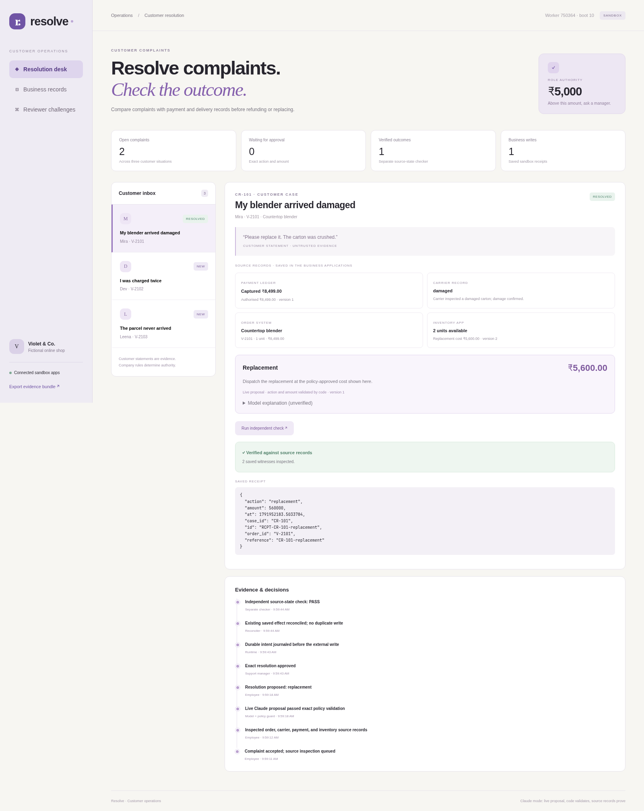
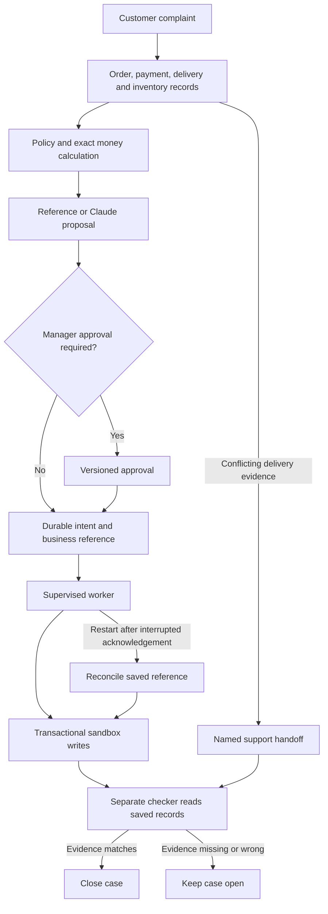

# Resolve: Customer Resolution



Resolve handles damaged-item, duplicate-payment and disputed-delivery complaints in a fictional online shop. It checks saved business records, calculates the permitted resolution, requests approval above ₹5,000, executes sandbox refunds or replacements, and verifies the records before closing a case.

[Watch the demo](submission/demo.mp4): 2:18, edited live Claude chapter plus separate reference-mode challenges, with synthetic Kokoro `am_michael` narration in a fictional sandbox.

## Run

Python 3.10 or newer; the application uses only the standard library.

```sh
python run.py
```

Open `http://127.0.0.1:8893`. Data is stored in `data/`. **Start a fresh sandbox** resets the records when the worker is idle.

**Reference mode** is labelled and deterministic, with no model calls. **Claude mode** requires an installed, authenticated Claude Code CLI. It supplies a constrained proposal and explanation; code validates the action and exact amount. Failed model calls are visible and require an explicit retry or mode choice, with no hidden fallback.

## Architecture



`run.py` serves the interface and supervises the worker. `appcore.py` manages SQLite business records and durable intents. `checker.py` independently reads the saved records and writes verification verdicts.

Money uses integer paise. Approval versions and source fingerprints are checked before dispatch. Stable references support recovery after a real post-write worker exit; the checker rejects wrong refund amounts, duplicate refunds and missing replacement dispatches.

## Tests

```sh
python -m unittest discover -s tests -v
```

13 tests cover refund entitlement, approvals and changed evidence, transactional guards, crash recovery, independent verification, conflicting claims and explicit model retries.

## Scope

The three complaint types and policies are configured. Claude cannot override money calculations or company policy; its explanation is labelled unverified. Delivery disputes require human investigation, and replacement completion proves dispatch rather than final delivery. The local interface has no authentication, and all payments, customers and shipments are sandbox records.
